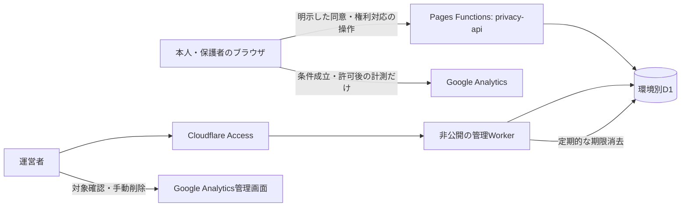

# Cloudflareの同意記録・削除受付：詳細設計案

**今回不採用の参考案。** 2026-10-13、本人は[GA4を見送る方針](GA4-OFF-DECISION.md)に同意した。以下のFunctions・D1・管理Worker・同意台帳・専用受付は導入しない。本文の次の判断は現在の公開前作業ではない。

2026-10-13 JST。本人が「既存Cloudflareに小さな非公開受付を置く案」を選択した。[子どもを含む公開計測の設計](GA4-PUBLIC-CHILD-DESIGN.md)をこの構成で具体化する。**今回の選択は設計の前提であり、実装・リソース作成・契約・計測の有効化の承認ではない。**

本番・評価のGA4はOFF。現在は静的Pagesで、Functions / Workers / D1 / 管理画面 / この受付は未導入。この文書は将来案で、管理設定・ゲーム・privacy.html・main・本番を変更しない。サブエージェントを使わない。

運営について本人は「受付があったことだけ通知する案」を選び、送信元として使えるCloudflare DNS管理の独自ドメインはないと回答した。本人が提案した[Apps Script Webアプリによる通知案](GA4-NOTIFICATION-DESIGN.md)を具体化する。週1回の巡回だけの運用は採用済みとせず、通知の実装・公開・送信も未承認。

## 1. 初期構成

受付を作る目的は、任意の同意操作を示すことと、過去のGAデータ削除を安全に受けること。ゲームイベントをCloudflareで独自に計測する機能は作らない。

| 部品 | 役割 | 初期案の範囲 |
| --- | --- | --- |
| 既存Pagesの静的ゲーム | 遊ぶ、説明を見る、本人/保護者が選ぶ、停止・削除依頼を操作する | 進行・音・答え・保存と共有機能を維持する。受付停止時も遊べる |
| Pages Functions | 同じサイト内の `/privacy-api/*` で同意・取消し・依頼・状態確認を受ける | 一覧、任意のID検索、Google管理APIを公開しない |
| D1 | 同意記録、受付案件、処理の最小限の履歴を保存する | 本番用と評価用を別のデータベースにする |
| 小さな管理用Worker | 運営者だけが受付を確認し、Googleへ手動対応した結果を記録する | Cloudflare Accessで保護。Googleへの削除自動実行は含めない |
| 同じ管理用Workerの定期処理 | 期限切れの情報を消し、消去処理の状態を記録する | 1日1回。公開の消去実行URLを作らない |

Pages FunctionsとD1の接続は[CloudflareのBindings](https://developers.cloudflare.com/pages/functions/bindings/#d1-databases)を基礎にする。`_routes.json`でFunctionの対象を `/privacy-api/*` に限定し、ゲーム・音声・画像は静的配信を続ける。[Functionsのルーティング](https://developers.cloudflare.com/pages/functions/routing/#functions-invocation-routes)。現在の公開ファイル許可リスト・ビルド・配信検査は、採用時にこの追加だけを明示して修正する。

独自ドメイン購入をこの案の前提にしない。管理WorkerはCloudflareが提供するホストで、当該Workerの本番・PreviewをすべてAccessで保護する候補。既存PagesのPreview保護だけでは、本番や別Workerの管理画面を保護したことにはならない。

### 管理方法の比較

Cloudflare標準のデータベース管理機能を使えば、専用画面の実装を減らせる。一方、日常の依頼処理がデータの直接編集に寄りやすく、状態の取り違えを防ぐ仕組みを別途要する。初期の通常操作は「受付を見る」「Google操作を記録する」に限定した小さな管理Workerを推奨し、標準画面は設定・障害対応用に使う。これは実装の比較で、標準画面の実際の表示を本人が確認済みという意味ではない。

## 2. 保存する情報

テーブル名・項目名は設計上の候補。実SQLスキーマはまだ作らない。

| 記録 | 主な項目 | 保存しない情報 |
| --- | --- | --- |
| `consents` | 内部の記録番号、控えの照合用ハッシュ、環境、役割、確認方法、説明/判断条件の版・言語、受付時刻、許可/取消し/失効の状態と日時、必要な既存GA client_id、消去期限 | 氏名、生年月日、年齢の数値、メール、住所、身分証、ゲームの答え・進行・入力・イベント履歴 |
| `rights_cases` | 案件番号、控えの照合用ハッシュ、環境、依頼種別、必要な既存client_id、関連する同意記録番号、受付/更新/Google操作の日時、状態、消去期限 | GAの行動履歴、問い合わせの自由文、返信用メール、Googleの認証情報 |
| `case_actions` | 案件番号、固定した操作/理由コード、実行日時、運営者の内部ロール、消去期限 | 依頼本文、IP、Cookie全体、client_idの重複コピー、管理者メールの重複コピー |
| `maintenance` | 最後の期限消去の成功時刻、件数、固定したエラーコード | 個々の利用者の情報や秘密の控え |

役割は `self_16_plus` / `guardian` 等の候補。16歳の基準・自己申告の妥当性は公開計測設計で残した確認事項で、Cloudflareを選んだことによって成立したとは扱わない。拒否・無操作の人のサーバー台帳を作るために識別子を発行しない。

内部の記録番号・案件番号は事務処理だけに使い、User-ID・プレイID・共有URL・GAパラメータにしない。説明の全文・画面と版の対応は変更履歴として別に保存し、個人別に全文コピーを増やさない。

GA client_idはブラウザを区別する識別子で、匿名化した集計値として扱わない。D1には権利対応と同意記録との対応に必要な範囲で保持する。アプリが独自にIP・User-Agent・参照元を台帳に保存する機能は設けない。Cloudflareが配信・認証・安全性のために扱う通信情報とログは別に説明する。

## 3. メールなしで使う「秘密の控え」

同意操作または削除依頼を受けた際に、十分な乱数から生成した秘密の控えを一度返す案。サーバーはその照合用ハッシュを保存し、平文の控えは保存しない。控えは事務上の認証情報で、ブラウザや人を継続して計測する目的に使わない。

- 同意の控え：この記録の取消し、対応する既存GAデータの削除依頼に使う。
- 削除依頼の控え：この案件の受付状況を見るために使う。
- 原則はこの端末内へ必要な期限まで保存し、本人が選べば手元へコピーできる。端末保存できない場合は先に伝える。ブラウザのデータを消す・端末を替えると失われる場合がある。
- 控えを持っていることで、実名の本人・親子関係・保護者の権限を証明したとはしない。控えから行動履歴を自動開示しない。
- 入力や送信は専用画面とPOST本文/認証ヘッダーに限定する。URLのクエリ・パス、履歴、参照元、共有リンク、GA、ログ、外部通知へ控えを入れない。

停止後も同意の控えが残り、D1の対応する既存client_idが期限内なら、GA Cookieを消した後でも過去データ削除を依頼できる候補。Cookieを復活させたりタグを起動したりしない。控えと対応情報を双方失った場合の復元を約束しない。

同意台帳を控えで操作できるAPIは権限をその1記録に限定する。案件の控えは状態確認に限定し、削除対象の変更・別人の記録閲覧・管理操作には使えない。

## 4. 利用者の操作とAPI

以下は契約案で、現在存在するURLではない。全APIは同じサイトのJSON POSTを基本とし、保存する環境・対象プロパティはサーバー設定から決める。ブラウザが送った環境名や測定IDだけで保存先を切り替えない。

| 経路候補 | 受ける操作 | 返す内容 |
| --- | --- | --- |
| `/privacy-api/consent` | 明示した許可、役割・確認方法、説明の版・言語 | 受理、同意の秘密の控え、適用条件と期限 |
| `/privacy-api/link` | 同意の控えと、許可済みタグから得た既存client_id | 関連付けの成否のみ |
| `/privacy-api/withdraw` | 同意の控えで取消しを記録 | 取消しを記録したか。端末の即時停止はこの応答を待たない |
| `/privacy-api/erasure` | 控えに対応する過去のGAデータ削除の依頼 | 受付、案件の秘密の控え。過去データの完全削除とは表示しない |
| `/privacy-api/status` | 案件の控えで状態を確認 | 固定した状態、受付/Google操作日、必要な説明だけ |

### 許可から開始まで

1. 起動時はOFF。過去のv1のgrantedは引き継がず、新しい訪問で説明に基づく明示選択を求める。無操作・拒否・GPC・旧い説明・条件未確定・運営者側OFFでは開始しない。
2. 必要な本人/保護者確認と許可操作が済んだ場合だけ受付へ記録する。端末側に説明の版、役割、選択、時刻、控えを必要な範囲で残す。サーバー時刻は独立に記録する。
3. サーバーはこの環境で採用済みの条件と説明の版を照合し、記録が受理されたことを返す。障害・条件不一致なら計測OFFで遊び続ける。
4. 受理後にタグを開始する。最初のGA通信はclient_idの関連付けより先に発生し得る。台帳はこの時点で「許可受理・ID関連付け待ち」とする。
5. 既に動作したタグからclient_idを取得できた場合だけ関連付け、状態を更新する。所定時間内に関連付けできなければ追加送信を止め、記録の不備を表示する。初回の送信もなかったことにはしない。

`link`は有効な控えを要求し、一度関連付けたIDを利用者APIで任意の別IDへ上書きしない。GAの既存識別子は自分で計測用に発行する仕組みではない。ブラウザからの値・Cookieだけでその人の身元を暗号学的に証明できるとは扱わず、対象の特定と本人/保護者確認を分ける。

### 取消しと削除

「今後の計測を止める」は先にローカルで送信停止・待機イベント破棄・GA Cookie消去を行う。既に送った通信を取り戻す操作とは説明しない。受付への取消し通知に失敗したら「この端末の計測は停止、記録への反映は未完了」と区別し、再試行できるようにする。再試行待ちを理由に再開しない。

削除の操作名の提案は「計測を止めて、過去データの削除を依頼する」。停止だけの操作と分け、削除処理中に同じ対象の計測を増やさない。既存の関連付けがあればサーバー側でそのclient_idを案件へ最小限引き継ぎ、受付を返す。同じ控えからの重複操作は同じ未完了案件へまとめる。受付に失敗した場合は端末の停止を維持し、控え・対象情報を失わず、依頼が成功したと表示しない。

同じサイトの別タブにも、計測の停止だけを通知する。ゲームの保存を消す操作にはしない。未完了の削除案件がある間は、この端末で計測の再許可を受け付けない案とする。Googleでの操作後に再開する場合も過去の許可を自動復活させない。別端末の計測や、既に送った通信まで即時停止できるとは表示しない。

関連付けがないが端末に既存IDがある場合、控えを失った場合、開示・訂正等の別の権利の場合は、自動照合済みとして処理しない。一般フォームでは識別子を送らず相談できるようにし、必要なら運営者が確認方法と専用の非公開受渡しを案内する。その例外経路の具体化も有効化前の条件に残す。控えを持っていない依頼を一律拒否する方針にはしない。[個別削除の方針](GA4-DELETION-PROCEDURE.md)。

## 5. 運営者の管理と手動対応

管理Workerの通常画面は「未対応案件」「対象の確認と処理記録」「期限消去の状態」の3つに絞る。ゲームの個人別行動履歴を表示せず、Googleのユーザー削除を自動実行するボタンを作らない。

当該Workerの本番・PreviewをAccessで保護し、アプリ側でも認証された運営者のみ許可する。Cloudflareの現在のWorker単位Accessは直接認証したリクエストで `ctx.access` を利用できる。管理WorkerにはStatic Assetsルーターを使わない構成を候補とし、未認証・想定外の経路・Service Binding経由は拒否する。採用時は実際の利用可能性を検証する。[Cloudflare Accessの公式仕様](https://developers.cloudflare.com/workers/configuration/cloudflare-access/)。単にヘッダーや管理URLの存在を確認して認証済みとはしない。

許可する運営者の情報はCloudflareの非公開設定に置き、メール・住所等の具体値をGitやチャットで提出させない。管理者に新しい公開メールを作る案ではない。認証した管理者のみにD1の閲覧・状態更新を許可し、Accessの設定が外れてもアプリ側で拒否する。アカウントの権限・認証・退任時の無効化も実装時に確認する。

通常の対応案：

1. [通知案](GA4-NOTIFICATION-DESIGN.md)に沿い、対応が必要な受付の存在だけを運営者へ知らせる。運営者は通知を受けて非公開管理画面を確認する。未対応・期限超過・期限消去の最終成功と通知失敗を表示する。通知メールへ案件の内容や識別子を転記しない。
2. 案件の環境と、許可操作・依頼の対応を確認する。client_idは必要な案件の詳細でのみ表示する。別人の対象を推測しない。
3. GAで対応するプロパティとclient_idを照合し、運営者が手動でユーザー削除を依頼する。[Googleのユーザー削除](https://support.google.com/analytics/answer/9283607?hl=en)。
4. 管理画面に操作日と固定した結果を記録する。利用者には「Googleへ削除を依頼しました」と表示する。取り消せないGoogle操作の実施は運営者が確認して行う。
5. Googleの説明する63日の期間経過は「処理期間が経過」と表示し、自動で実データの完全削除を検証したとは表示しない。追加対応が必要なら案件の状態を更新する。

目標は受付後7日以内の確認、通常の権利対応について1か月以内の進捗・結果案内。Google側の処理日数とは別。本人は通知を設計する案を選択済み。メールの到達・閲覧を確認済みとはしない。確認を続けられない場合の新規計測停止と、既存の権利対応の継続を分ける。

案件の状態案は `received` → `reviewing` → `google_requested` → `processing_window_elapsed`。対象不明・確認が必要なら `needs_verification`、保持期間等で対象明細が確認できないなら `not_identified`。後者は「そのデータが一切存在しない」「すべて消去済み」の断定には使わない。

## 6. 保存期限の具体案

以下は**本人確認と法的判断の前の運用候補**。法定の一律期限ではない。一般問い合わせの解決後30日、GAのイベント保持2か月、Cookieの期限、同意台帳、受付記録、復元履歴を区別する。

| 対象 | 通常の期限案 | 理由と例外 |
| --- | --- | --- |
| 既存IDの関連付けが完了しなかった同意記録 | 1日以内に通常データから消去 | 長期間の利用者記録にしない。既に案件になった場合はその対応に必要な分だけ別扱い |
| 同意の見直し・GA Cookie | それぞれ60日以内。訪問ごとに明示選択 | Cookie更新で延々と期限を延ばさない。現在の180日設定を変更するかは別途採用する |
| 完了した同意台帳と控えの照合情報 | 同意から最大150日を初期候補 | 最大60日の許可期間後もGAの明細保持と対応に必要な記録を短期間残す案。150日が法的に十分と判断済みではない |
| 削除対象のclient_id | Googleへの操作後63日を目安に、対象の案件・関連台帳から同期して消去 | Google処理中の再確認用。台帳に同じ値を残して消去済みとは扱わない。未処理・再対応ならその案件に必要な範囲と再評価日だけ記録して保持 |
| 案件・控え・処理履歴 | 上の処理期間経過後30日以内に消去 | 受付状況と追加相談のため。Google操作なしで対応終了した案件は終了後30日以内 |
| 期限消去の状態 | 最終成功・直近の固定したエラーだけ | 個人の対象一覧や無期限の実行履歴を残さない |

未完了案件があるから全員の台帳を延長する運用にしない。必要な関連記録だけ保留理由・再評価日を残す。削除対象の関連台帳は通常の150日より早く最小化する。必要な同意証明を残す場合も、項目・根拠・期限を別に判断し、台帳を一律に消去義務から除外しない。集計済みGAデータの扱い、同意を証明すべき期間、権利対応の期限・法的な保持がこの案で足りるかを確認してから最終期限を確定する。150日を同意の有効期限やGAの保持設定として使わない。

### 定期消去と復元履歴

管理WorkerのScheduled Handlerを1日1回実行し、消去期限に索引を付けた対象を少量ずつ削除する。各APIも期限切れの控えや同意を有効扱いせず、定期処理の遅れで計測許可を延ばさない。期限消去の成功が36時間より古い場合は新規の許可を受けず、既存の権利受付を維持する案。初回も正常な期限消去を確認するまで新規受付を開かない。[Cloudflare Cron Triggers](https://developers.cloudflare.com/workers/configuration/cron-triggers/)。正常稼働中の実消去には最大1日の遅れがあることを期限の表示に反映する。障害時は運営者が復旧して再処理し、失敗中も期限どおり消えたと扱わない。

D1 Time Travelは常時有効の復元機能。現在の公式上限はWorkers Freeが7日、Paidが30日。[D1の上限](https://developers.cloudflare.com/d1/platform/limits/)・[Time Travel](https://developers.cloudflare.com/d1/reference/time-travel/)。SQLで消しても復元履歴から即時にすべて消去されるとは表示しない。実際のプランと契約を確認し、その追加期間を通知へ反映する。D1以外のCloudflareのログも同じ期限で消えると約束しない。

独自のR2/PC/Gitへの台帳バックアップやCSVの定期書き出しは初期案に含めない。復元は運営者の別の判断とし、受付・計測を停止した状態で行う。消去期限と取消し・削除を再適用し、復元時点以後の状態を確認できない記録を通常運用へ戻さない。過去の許可を復元しただけで計測を再開しない。

## 7. アクセス・悪用・障害の境界

- 許可するOrigin、説明の版、環境、役割、項目・長さをサーバーで検証する。JSON本文の上限案は4KiB、未知の項目は拒否、SQLはパラメータ化する。入力の自由文やCookie全体を保存しない。
- 状態を変えるGET、ワイルドカードCORS、任意のIDを検索する公開APIを作らない。控え照合は対象の1記録に限定し、無効/期限切れの応答から別人の存在を調べられないようにする。
- Functionsのレスポンスに直接 `Cache-Control: no-store`、`Referrer-Policy: no-referrer` 等を設定する。静的 `_headers` はFunctions応答へ自動適用されない。[CloudflareのHeaders説明](https://developers.cloudflare.com/pages/configuration/headers/)。管理画面もキャッシュや第三者計測を使わない。
- 本文、SQLの引数、Cookie、秘密の控え、client_idをconsoleや例外ログへ転記しない。運用に必要な固定したエラーと件数だけを使い、Cloudflare側の自動ログ設定と保持は設定時に確認する。
- 短時間の受付数と同じ控えからの重複を抑える。通信元を安全性の制限に使う必要がある場合も短期・目的限定で評価し、IPの履歴や指紋識別を台帳へ追加しない。ボット対策のための外部スクリプト・Turnstile・メールサービスを自動で追加しない。
- 受付・D1・認証・消去処理の障害や無料枠の枯渇は、成功として扱わない。新規の計測は停止側へ倒し、既存の依頼の対応は継続する。一般フォームは識別子なしの障害相談として案内する。
- 新規同意を受ける設定と、既存の取消し/削除/状態確認を受ける設定を分ける。GAを止めると同時に権利受付まで閉じる仕組みにしない。

## 8. 本番・評価・費用

本番と評価はD1、管理Worker、Accessの保護対象、必要な非公開設定を分離する。Previewへ本番D1を接続しない。評価は固定した許可ホストだけに限定し、別Previewやlocalhostは実サービスを呼ばずローカル/モックで確認する。送られた環境名で本番へ昇格する経路を作らない。本人のCF画面でProduction/Preview選択が見つからなかった経緯を維持し、設定する段階で実際の画面とバインディング先を確認する。

Cloudflareに新しいAPIを配置しても、GA4承認フラグ、origin一致、利用者の有効な許可、必要な確認は別条件。`SANTA_GA4_POLICY_APPROVED=false`を維持する現在の設計作業では、公開の受付や管理URLも作成しない。

料金の検討は無料枠を第一候補にする。D1 Freeには日500万行read・10万行write・合計5GB等の枠があり、走査した行数や消去も利用量に含まれる。[D1の料金](https://developers.cloudflare.com/d1/platform/pricing/)。Functions / Workersの実行、Accessのプランも別に確認する。[Workersの料金](https://developers.cloudflare.com/workers/platform/pricing/)・[Zero Trustのプラン](https://www.cloudflare.com/plans/zero-trust-services/)。通常の自己登録という報告だけから現在のプランをFreeと断定しない。

無料枠は同じアカウントの他の利用と影響し合う場合がある。公開規模・受付数・悪用対策が未定なので、必ず無料で収まるとは約束しない。索引を使い全件走査を減らし、使用量と上限時の挙動を確認する。有料化・新しい契約・独自ドメイン購入は、費用を示して本人と別に決める。

## 9. 採用後に増える実装と確認

実装候補は、Pages Functionsの小さな受付、D1のスキーマと期限索引、管理/定期消去Worker、ブラウザの同意・控え・削除UI、公開許可リストと配信検査への追加、日英の通知。別途本人が選んだ[受付の存在だけを知らせる通知案](GA4-NOTIFICATION-DESIGN.md)も設計する。GA管理API、一般フォームへのID受付、通知本文への利用者情報、年齢認証サービス、User-IDは自動で含めない。

大きな変更なので、実装を採用した場合は次を確認する。設計文書だけの現在はこれらの試験を実施済みとは扱わない。

| 確認 | 成功の条件 |
| --- | --- |
| 同意・既存許可・共有端末 | 無操作/v1/別タブ/条件不一致ではGA通信なし。必要な確認と受理を経て開始する |
| 取消し・遅いタグ・通信障害 | 取消し後に再開しない。受付の失敗でもゲームの進行・音設定を維持する |
| client_idと控え | 新しい計測IDを権利対応だけのために発行しない。対応する既存IDだけを扱い、URL/ログ/GAへ控えを出さない |
| 認証・環境分離 | 非管理者/Accessなし/別環境/別控えは対象を閲覧・変更できない |
| 期限・復元・上限 | 期限を過ぎた許可は無効。期限消去が成功し、復元で取消しや消去を取り消さない。上限時は成功を偽らない |
| ゲームと静的配信 | 物語・答え・音・保存キー・箱の自由な順序・救出経路を維持する。API以外を不要にFunctionへ通さない |

最初はローカル/モックで行う。クラウドへの配置、実GA送信試験、Googleでの実削除、mainマージ、本番公開はその時点の別の判断。

## 10. 次の一つの判断

**本人は「受付があったことだけ通知する案」を選択済み。** [Apps Scriptを呼ぶ具体案](GA4-NOTIFICATION-DESIGN.md)に、固定の文面、専用署名、短期の重複照合、失敗の扱いを示す。次の一つの判断は毎日まとめて通知するか、新規の受付の都度知らせるか。これは通知の設計で、送信や外部サービス契約を行う指示ではない。

その後、保存期限案、例外の権利受付、保護者確認・対象地域・契約/移転の判断と通知を確定する。このCloudflareの詳細設計だけで子どもの公開計測が適法・有効化可能と結論しない。
