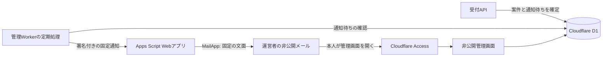

# 受付があったことだけを知らせる通知：Apps Script案

**今回不採用の参考案。** 2026-10-13、本人は[GA4を見送る方針](GA4-OFF-DECISION.md)に同意した。GA用の追加受付・GAS通知・フォームへの識別子受付は導入しない。本文の頻度や方式の選択は現在の公開前作業ではない。

2026-10-13 JST。本人が「受付があったことだけ通知する案」を選び、Cloudflare DNS管理の送信元ドメインはないと回答した。そのうえで、Google Apps ScriptのWebアプリを呼ぶ方法を提案した。この方法を通知の設計候補として具体化する。

**今回は設計のみ。** Google/Cloudflareのリソース作成、Webアプリ公開、認可、設定変更、通知の実送信は行わない。GA4は本番・評価ともOFF。mainマージ・本番公開・サブエージェント利用は行わない。[Cloudflare受付の詳細設計](GA4-CLOUDFLARE-RECEIPTS-DESIGN.md)を引き継ぐ。

その後、本人がGoogleフォームの事前入力URLを利用者に開いてもらう方法を提案し、URLへ入れる値は「削除対象を特定するGAの識別子（client_id）」と回答した。[フォーム案の比較](#8-googleフォームの事前入力urlという追加案)へ進む。GAS案の通知頻度は未選択で、フォーム案を比較する前に実装の採用や頻度を確定しない。

## 1. 目的と構成

運営者の対応が必要な新しい削除等の受付を、メールで知らせる。通常の許可・拒否・取消しの記録を一件ずつ通知して、プレイ数の通知へ転用する仕組みにはしない。



削除対象・同意台帳はCloudflareへ保存し、GASへは通知のための固定した操作と送信制御用情報だけを渡す。依頼者のブラウザからGASを呼ばせない。受付は先にD1へ確定し、メールの成功を待って利用者の受付結果を返す構成にはしない。

Apps Scriptは `doPost(e)` でHTTP POSTを受けられ、Webアプリを所有者の権限で実行する設定がある。[GoogleのWebアプリ仕様](https://developers.google.com/apps-script/guides/web)。メールは `MailApp` を使う候補で、Gmailの受信箱を読む機能は必要ない。[MailApp](https://developers.google.com/apps-script/reference/mail/mail-app)。運営者の既存の個人用Googleアカウントでの利用を第一候補とするが、実際の公開・認可の可否を確認済みとはしない。

独自ドメインの購入はこの案に不要。Cloudflareのメール送信は送信元ドメインをEmail Serviceへ登録する条件があるため、今回の本人回答では最初の候補にしない。[Cloudflareの送信元条件](https://developers.cloudflare.com/email-service/configuration/send-bindings/)。ゲーム用Custom domainがないことと、アカウントの他の送信元ドメインの有無を区別し、今回は後者も本人が「ない」と回答した記録とする。

## 2. 文面と宛先

通知は運営者の固定した1アドレスへ送る。宛先を来訪者や受付本文から指定できるAPIにしない。CC/BCC、添付、開封追跡、外部画像は使わず、テキストのみの候補とする。

件名案：

```text
サンタの脱出：受付を確認してください
```

本文案：

```text
対応が必要な受付があります。
非公開の管理画面を確認してください。

管理画面：〈固定した管理画面のURL〉
```

管理URLは通常の入口だけを示し、個別案件のパス・クエリ、ログイン用トークン、秘密の控えを含めない。メールのリンクからでもAccessと運営者の確認を通す。管理画面のURLを秘密として扱うだけで閲覧を保護したことにはしない。

通知には依頼内容、client_id、Cookie、氏名、メール等の依頼者情報、年齢・保護者役割、案件番号、件数、受付の正確な日時を入れない。通知の発生とメールの送信時刻は運用上の情報として残るため、「外部へ一切の情報が渡らない」とは説明しない。

公開の相談先は既存Googleフォームを維持する。通知用メールの具体値は本人が非公開の設定画面へ入力し、Git・公開ページ・チャットへ提出させない。Googleの公開設定やシステム画面で運営者情報がどう表示されるかも、配置前に確認する。

## 3. Cloudflareから渡す項目と認証

WebアプリをサーバーからGoogleログインなしで呼ぶ場合、呼出し用URLに到達できる入口を設ける必要がある。Apps Script編集権限まで共有する必要はない。公開設定の可否・表示は配置を採用した段階で本人と確認する。

URLを知っていることだけを認証にしない。通知専用の共有秘密でHMAC-SHA256署名を検証してから送信する候補。Apps Scriptの `doPost` イベント仕様には任意のHTTPヘッダー取得が示されていないため、Authorizationヘッダーを読み取れる前提にせず、署名をJSON本文へ入れる。[Webアプリのイベント](https://developers.google.com/apps-script/guides/web#request_parameters)・[UtilitiesのHMAC](https://developers.google.com/apps-script/reference/utilities/utilities#computeHmacSha256Signature(String,String))。

| 通知用項目 | 用途と制限 |
| --- | --- |
| `version` | 固定した通知プロトコルの版 |
| `kind` | 固定値 `receipt_attention`。自由な本文・操作名は受けない |
| `delivery_id` | 通知単位の十分な乱数。同じ通知の再送を見分ける。GA/案件番号/利用者の控えから作らない |
| `issued_at` | 送信を試みる側の時刻。受付日時ではない。古い署名の再利用を拒否するため |
| `signature` | 上の許可項目を決めた順序・形式で署名した値。秘密そのものは送らない |

本文の上限候補は2KiB、未知の項目・不正な形式・固定値以外を拒否する。署名はUTF-8の確定した形式を双方で一致させ、時刻差の許容案は5分。`delivery_id`を再送する際も新しい送信時刻で署名する。

秘密はCloudflareのサーバー側Secretと、所有者だけが編集するGASのScript Propertiesへ置く。Script Propertiesはスクリプト内で共有される設定なので、誰でも見られる安全な保管場所とは扱わない。編集者を増やす場合は権限と秘密の変更を確認する。[Properties Service](https://developers.google.com/apps-script/guides/properties)。ブラウザ、Git、ビルド済み静的ファイル、URLクエリ、実行ログへ入れない。

## 4. 通知待ち、再送、重複

1. 対応が必要な受付の確定と、Cloudflare側の通知待ち状態の更新を同じ処理として行う。受付の案件番号・未確認範囲はD1内で扱い、GASへ渡さない。
2. 定期処理が通知待ちを確認する。初期の頻度候補は**毎日1回、未確認の受付がある場合だけ**。通常のメールは1日1通までにまとめ、確認を開始した案件は催促の対象から外す。
3. 送信対象の範囲と `delivery_id` を固定して署名付きPOSTを行う。送信中に新しい受付が増えても、成功した通知に含めた範囲だけを通知済みへ更新し、新しい受付の通知待ちを消さない。
4. GASは形式・署名・時刻を検証し、送信制御の情報をロックして重複を確認する。有効な通知だけ、固定の宛先と文面で `MailApp.sendEmail` を実行する。[LockService](https://developers.google.com/apps-script/reference/lock/lock-service)。
5. MailAppから正常に戻った後に送信受理の記録を残し、固定したJSON結果と同じ `delivery_id` を返す。Cloudflareは対応する結果を確認した場合だけ、通知サービスに受理されたと記録する。受信箱へ届いたこと・読まれたこと・依頼に対応済みの意味にはしない。
6. 失敗・応答不明なら同じ `delivery_id` で再試行する。無制限の即時ループはせず、次の定期処理で試す。新しい受付や未確認の催促は別の通知単位にする。

GASの送信済み識別子の照合情報は最長7日を候補とし、古い分を消す。同じ通知の再試行も7日までとし、それ以降は送信障害として運営者の対応が必要な状態にする。7日を権利対応の待機期間として使わず、失敗が続く場合の確認を前倒しする。Cloudflare側は最後の受理/失敗時刻と固定した状態、必要な通知単位だけを残す。通知用に個別案件をGASへ複製しない。

メール送信とGASの記録は一つのトランザクションにできないため、障害のタイミングによる重複を完全には排除できない。通常の1日1通と、まれな再送による重複を区別する。受付を失うことや未送信を送信済みとすることを避け、Googleからの応答・送信制限を確認する。[Apps Scriptの利用上限](https://developers.google.com/apps-script/guides/services/quotas)。

## 5. HTTP応答と失敗の扱い

GAS Content Serviceの応答は一時的な `script.googleusercontent.com` のURLへリダイレクトされる。[Content Service](https://developers.google.com/apps-script/guides/content#redirects)。HTTP 200やリダイレクトだけでメールが送れたと判断しない。実装時には、初期URLを既定の `script.google.com` の呼出し先に限定し、許可したGoogle応答ホストとHTTPSだけを少数回たどる。署名本文や認証情報を別ホストへ再POSTしない。最終のJSON・プロトコル版・通知識別子・結果を確認する。

受付・計測の状態と通知の状態を分ける。通知失敗で利用者の取消しを取り消したり、GAの許可を増やしたり、受付を消したりしない。管理画面は通知待ち/サービス受理/失敗、最終確認時刻を表示する。Google側のMailApp認可取消し、Webアプリの版・URL変更、上限、実行失敗も成功として扱わない。

通知と期限消去を同じ定期処理から呼ぶ場合も、成功・失敗を独立に扱い、通知失敗で期限消去を中断しない。通知未受理が24時間以上続く場合や、運営者が未確認の受付が7日を超えた場合には新規の許可を受けない案とし、既存の依頼と取消しの受付は続ける。この停止で未対応案件の対応義務を済ませたことにはしない。開始前には、本人の明示した通知テストで実受信と迷惑メールの扱いを確認する。

署名で不正メールを抑えても、公開GAS入口への不正アクセスが実行資源を使う可能性は残る。Googleの制限・本人アカウントの他用途への影響と、方式変更の必要性を評価する。新規計測を停止側へ倒す条件と、既存の権利対応を続ける手段を保持する。メールだけを受付台帳にせず、運営者が7日以内の確認を続けられる運用を有効化前に確定する。

## 6. 方法の比較と処理先

| 方法 | 利点 | 追加の範囲 |
| --- | --- | --- |
| CloudflareからGAS Webアプリを呼ぶ（本人の提案） | 送信元ドメイン購入を避け、既存GoogleアカウントのMailAppを使える。CFの通知待ち・定期処理をまとめられる | GASの呼出し用入口公開、署名・再送・版管理が必要 |
| 非公開GASがCFの通知有無を定期的に確認する | GASのWebアプリ公開を避けられる | CFに通知有無だけを返す認証APIと、GAS側の定期実行・認証情報を追加する。予定どおりの時刻を保証するものではない。[定期トリガー](https://developers.google.com/apps-script/guides/triggers/installable) |
| Cloudflareのメール送信 | 処理基盤をCF側へまとめられる | 通知の送信元ドメインが必要。今回は利用できるドメインなしとの本人回答 |

最初は本人が提案したWebアプリ呼出し案を具体化する。APIを公開したくない場合や濫用・運用の負担が大きい場合は、定期確認案を比較する。どちらも現在導入した仕組みではない。

Googleには運営者の通知用アドレス、固定メール、通知の送信制御用情報と通信が伴う。Googleフォームの一般相談・GA計測・このMailApp通知は別の処理として整理する。個人用GoogleアカウントにWorkspaceのDPAが適用済みとはしない。通知用の一般情報へ減らしても、契約・保持・国外処理が無関係になったと判断しない。

## 7. 採用時の追加と次の判断

追加候補は、CFの小さな通知待ち状態と送信処理、GASの署名付き受信/固定MailApp送信/短期の重複照合、非公開設定、管理画面の通知状態。公開URLへの訪問者の送信機能、Google OAuthトークンの受渡し、返信先の入力、GoogleフォームへのGA識別子受付は増やさない。

採用後はモックで、署名不正・古い署名・未知項目・同時実行・応答不明・送信中の新規受付・未確認の催促・上限・Googleリダイレクト・ログへの混入を検証する。実メール送信は、その具体的なテスト宛先・件名・回数を示して本人が明示的に指示した場合に限る。現在はコード・GASプロジェクト・公開設定・実送信を作成しない。

次の一つの判断は、**通知を毎日1回まとめるか、新しい受付の都度知らせるか**。毎日まとめる案は通知量と受付時刻の粒度を減らし、7日以内の受付確認の目標に合わせる。選択後、保存期限・例外の権利受付・保護者確認・対象地域と契約/通知の判断へ進む。

## 8. Googleフォームの事前入力URLという追加案

本人が「Googleフォームでqueryパラメーターに値をいれたURLを作ってユーザーに押させればいいのでは」と提案した。Googleフォームは事前入力リンクと新しい回答のメール通知を備え、[既存フォーム](CONTACT-FORM.md)の送信・メール通知は本人が確認済み。[事前入力の公式手順](https://support.google.com/docs/answer/2839588?hl=en)・[回答の通知](https://support.google.com/docs/answer/139706?hl=en)。**リンクを開くことと、フォームの送信は別**で、開いた時点で受付・通知済みとは表示しない。

| URLへ入れる候補 | 判断案 |
| --- | --- |
| 「GAデータ削除の依頼」などの固定した種別・文面 | 事前入力で操作を減らせる。固定文だけでは個別のGA削除対象は特定できない |
| 非秘密の受付参照番号 | CFにある案件との手動照合を検討できる。閲覧や取消しの権限を持つ控えとは分ける。CF側の対応は残り、対応可能な番号は仮名化した情報として取り扱いを評価する |
| GA client_id、Cookie、秘密の控え、認証情報 | URLへの搭載は採用しない案。ブラウザ履歴・ログ・コピー/共有等へ値が残り得る。HTTPSだけではURLの情報露出を防げない。[OWASPの説明](https://community.owasp.org/vulnerabilities/Information_exposure_through_query_strings_in_url) |

フォームを**受付本体**にするなら、利用者がフォームで送信した時点を受付とし、標準の回答通知を利用できるためCFの削除受付やGAS通知を省ける可能性がある。ただし、安全な削除対象の受渡し、Googleへの情報保存、個人用アカウントの条件、保持・照合・返信/状態確認を見直す。現在の「フォームへGA識別子を入れない」という方針を変更する設計であり、変更を採用済みとはしない。保護者確認と同意記録をこれだけで置き換えたとも扱わない。

CFで**先に受付を確定してから、フォームで通知してもらう**なら、通知用GASを省ける一方、利用者に追加の移動と送信が必要。フォームの中断・未送信でもCFの受付は残り、通知されない案件の確認手段が必要になる。任意の追加送信だけを唯一の受付通知として、全案件で通知が届くと約束しない。

事前入力された値は認証・署名ではなく、利用者が編集したりURLをコピーしたりできるものとして扱う。入力だけで本人/保護者や削除対象を確認済みとせず、フォーム回答を受けただけでGAの削除を自動実行しない。

本人はURLへ入れる値としてclient_idを選択した。client_idはパスワードや管理画面の認証情報ではないが、今回ブラウザの行動データと関連する識別子として扱う。事前入力URLならフォームを開いた段階でその値がGoogleのURLへ渡り、回答を送信する前から履歴等へ残り得る。URLの値が削除対象の特定を助けても、本人や保護者の権限を証明するものではない。

簡素化する代替案は、ゲーム内の本人の操作で取得可能な**既存**client_idを確認・コピーし、Googleフォームの専用欄へ貼り付けてから送信する方法。個別削除の受付と標準の回答通知をフォームにまとめるなら、通知用GASを省ける。URLへの残存を減らせる一方、コピー/貼付の操作が増え、Googleフォームにも識別子を保存する変更になる。フォームの事前入力は非識別の固定文・種別だけに使う候補とする。

この代替案を採用する前に、個人用Googleアカウントでの子どもを含む海外向けの取扱条件、説明・項目・保持・削除対象の照合・メールなしの進捗確認を再評価する。Googleフォームへの識別子の保存が一律に禁止されていると判断したものではなく、これまでの窓口の用途と方針との差分。保護者同意の記録と、既存IDを得られない場合の相談は別に残る。権利対応のためにGAを新しく許可したり新しい識別子を発行したりしない。

現在は比較と方針の提案のみ。実際のURL生成、フォームの項目・設定変更、回答送信は行わない。計測OFFを維持する。
